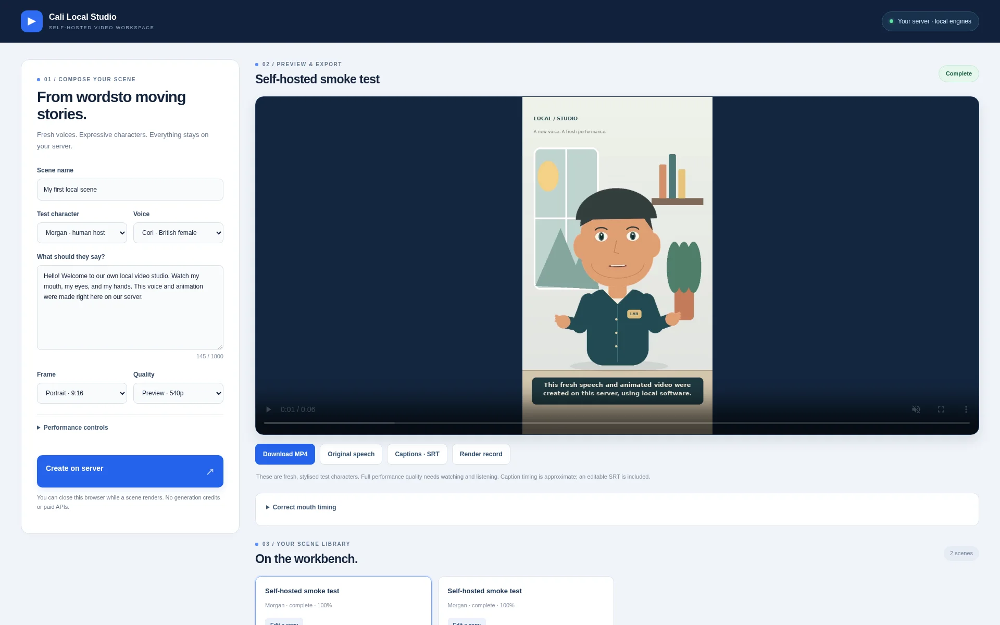

# Cali Local Studio

**Self-hosted speech, animated 2D characters and finished video — on your own CPU.**

Write a script, pick a local voice and character, and render an MP4 in one browser workspace. No generation credits, provider account or paid API key is required. Setup downloads open-source packages and local model files; generation then runs on your machine.



## What it does

- Local neural speech with two English Piper voices; optional VoiceStudio integration.
- Original human and canine 2D rigs: mouth poses, blended speech timing, blinking, gaze, head movement and gestures.
- Portrait/landscape preview and Full HD H.264/AAC exports at 24fps.
- Captions, original WAV, mouth cues and a render-evidence record alongside each MP4.
- A persistent job queue, cancellation, restart recovery and non-destructive mouth-cue revisions.
- A responsive editor, large screening area and scene library. All rendering happens on the server, so closing the browser does not cancel a job.

This is an early, working **2D rig-based studio**. It does not implement arbitrary photo-to-video, automatic new-character rigging, voice cloning, text-designed custom timbres or a 3D scene editor. Automatic mouth/caption timing needs playback review. The supplied test characters are original examples, not the company's production mascot assets.

## Quick start with Docker

Supported packaged target: **Linux x86-64**. Docker must be running and Compose v2 available. No NVIDIA GPU is needed. Allow at least 2 CPU cores, 2GB RAM and several GB of disk; longer/HD scenes take more time. Initial model downloads total roughly 120MB, in addition to the image and alignment tool.

```bash
git clone https://github.com/Call-OnDad/cali-local-studio.git
cd cali-local-studio
docker compose up --build -d
docker compose logs -f studio
```

Once setup finishes, open **[http://localhost:8780](http://localhost:8780)**. On another device on your trusted LAN, use your server's LAN address and port 8780.

There is deliberately **no user login**. The server checks local/private client networks, allowed Host names and mutation origins. Keep it on a trusted LAN or behind your own authenticated private access; do not port-forward it to the public internet. Edit `.env.example` into your own ignored `.env` if you need narrower networks or a local DNS hostname.

Projects and models are stored in separate named volumes. `docker compose down` keeps them. **`docker compose down -v` deletes those volumes and their projects/models.**

### Offline operation

Generation uses installed local models and tools, without a hosted fallback. After setup, set `STUDIO_DOWNLOAD_MODELS: "0"` in the Compose service environment to skip startup download checks. Cached files must remain available.

For enforced offline operation, apply an outbound firewall policy on your server or router that preserves your LAN access. The default Compose network is not an internet firewall. Docker internal-only networks were tested: local rendering worked, but published LAN ports became inaccessible, so that configuration is deliberately not shipped as a working LAN solution. The original native deployment separately verified rendering under a host-level outbound block.

## Native Linux installation

Debian 13 / Python 3.13 is the reference environment. Other Linux distributions may need equivalent system packages; native Windows/macOS execution is not validated.

```bash
sudo apt-get update
sudo apt-get install -y python3-venv ffmpeg fonts-dejavu-core ca-certificates
python3 -m venv .venv
.venv/bin/pip install -r requirements.lock.txt
.venv/bin/python scripts/setup_assets.py
sh scripts/run-local.sh
```

The setup script checks pinned SHA256 values for weights/configs and the Rhubarb release archive. It retains individual voice model cards. If a checked asset changes, setup fails rather than silently installing different assets. Models and third-party binaries are not committed to this repository. `requirements.lock.txt` records the tested Python package versions; `requirements.txt` holds maintenance constraints.

## Use the studio

1. Choose a character and an installed voice.
2. Enter a scene name and script; choose portrait/landscape and preview/HD.
3. Optionally adjust speech speed, gesture intensity, mouth opening and timing offset.
4. Create the scene and review the complete video with sound.
5. Download MP4, WAV, SRT or the render record. The advanced cue editor produces a new revision, preserving the previous version.

The source speech is retained separately from AAC delivery audio. Sentence captions are approximate, not forced word alignment. Existing stage outputs can be reused when a job resumes; an evidence record is a mechanical check, not human approval of a performance.

## Configuration and optional VoiceStudio

See [configuration](docs/configuration.md) for environment variables and [VoiceStudio integration](docs/voicestudio.md) for the optional local speech adapter. The basic installation works without VoiceStudio or any speech-service credentials.

No hosted fallback is configured. The optional adapter is intended for a VoiceStudio instance you control, not a cloud-generation service. We did not enable its default OmniVoice weights because their terms differ from the application/code licence. Individual model terms must be checked separately.

## Test and maintain

```bash
.venv/bin/python -m unittest -v test_controls
.venv/bin/python scripts/smoke_test.py --url http://localhost:8780
```

The first command tests controls with the worker stubbed; the second requests a real new speech/animation render. See [validation](docs/validation.md). Back up the project volume before updating. Pin the image/source and record model hashes for the version you deploy.

For a running Docker installation, use `docker compose exec studio python scripts/smoke_test.py`. The packaged control tests can be run with `docker compose exec studio python -m unittest -v test_controls`.

## Licence and credits

Original studio code and example rigs: **[MIT](LICENSE)**. Third-party engines, packages and model/dataset terms are separate; retain their notices and review the individual model cards before publishing or redistributing assets. See [third-party notices](THIRD-PARTY-NOTICES.md).

This project avoids per-generation provider fees. Your own hardware, electricity, storage and maintenance still have costs. It is not affiliated with Piper, Rhubarb, VoiceStudio or their model publishers.
